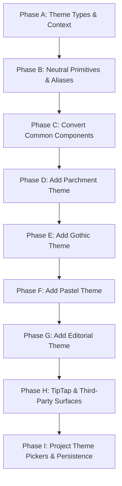

# Apollonography Multi-Theme System Architecture & Migration Plan

**Target Application:** Apollonography (React Native Windows C++ Template 0.84, TypeScript, NativeWind v4)  
**Status:** Architecture & Implementation Plan  
**Target File:** `PLAN.md` (Project Root)  
**Execution Target:** Gemini in Antigravity  

---

## 1. Codebase Audit

A comprehensive audit was conducted across all 50 source files in `src/` to identify hardcoded tokens, styling patterns, and dependencies on brutalist design primitives.

### 1.1 File-by-File Token & Dependency Counts

| File Path | Hex Literals | Brutal Tokens | Brutal Primitives | NativeWind Classes | Fonts Referenced | Total Violations |
| :--- | :---: | :---: | :---: | :---: | :---: | :---: |
| `src/components/EditorCanvas.tsx` | 57 | 87 | 70 | 446 | 0 | **660** |
| `src/screens/MainScreen.tsx` | 68 | 88 | 55 | 120 | 1 | **332** |
| `src/components/ChapterWriterCanvas.tsx` | 37 | 70 | 27 | 6 | 21 | **161** |
| `src/components/ProfileSettingsModal.tsx` | 36 | 81 | 19 | 0 | 12 | **148** |
| `src/components/AbilityList.tsx` | 16 | 34 | 16 | 81 | 0 | **147** |
| `src/components/AttributeDropdown.tsx` | 49 | 14 | 15 | 51 | 0 | **129** |
| `src/components/AbilityIconPicker.tsx` | 36 | 43 | 10 | 38 | 0 | **127** |
| `src/assets/editor/editorHtml.ts` | 119 | 0 | 0 | 0 | 5 | **124** |
| `src/components/WysiwygEditor/WysiwygEditor.tsx` | 18 | 67 | 21 | 0 | 17 | **123** |
| `src/components/HomeDashboard.tsx` | 2 | 41 | 24 | 30 | 0 | **97** |
| `src/components/ProjectModal.tsx` | 25 | 64 | 8 | 0 | 0 | **97** |
| `src/components/WysiwygEditor/WysiwygToolbar.tsx` | 6 | 55 | 14 | 0 | 14 | **89** |
| `src/components/WysiwygEditor/WysiwygHistory.tsx` | 9 | 46 | 18 | 0 | 12 | **85** |
| `src/components/Sidebar.tsx` | 7 | 39 | 13 | 20 | 0 | **79** |
| `src/components/SeriesShowcaseCanvas.tsx` | 0 | 30 | 26 | 19 | 0 | **75** |
| `src/components/WysiwygEditor/WysiwygStatusBar.tsx` | 10 | 37 | 18 | 0 | 9 | **74** |
| `src/components/ImageCropperModal.tsx` | 2 | 14 | 11 | 45 | 0 | **72** |
| `src/components/WysiwygEditor/WysiwygFindReplace.tsx` | 2 | 15 | 11 | 44 | 0 | **72** |
| `src/components/WysiwygEditor/WysiwygViewSettings.tsx` | 8 | 19 | 6 | 26 | 0 | **59** |
| `src/components/WysiwygEditor/WysiwygFootnotes.tsx` | 6 | 27 | 14 | 0 | 4 | **51** |
| `src/components/WysiwygEditor/WysiwygExportModal.tsx` | 4 | 26 | 14 | 0 | 3 | **47** |
| `src/utils/abilityUtils.ts` | 46 | 0 | 0 | 0 | 0 | **46** |
| `src/theme/brutal.ts` | 11 | 28 | 1 | 0 | 4 | **44** |
| `src/components/MiniTipTapEditor.tsx` | 19 | 22 | 0 | 0 | 2 | **43** |
| `src/data/mock.ts` | 31 | 7 | 0 | 0 | 3 | **41** |
| `src/components/WysiwygEditor/WysiwygBacklinks.tsx` | 3 | 23 | 8 | 0 | 6 | **40** |
| `src/components/ImageLightbox.tsx` | 2 | 36 | 0 | 0 | 0 | **38** |
| `src/components/brutal/BrutalButton.tsx` | 0 | 27 | 7 | 1 | 0 | **35** |
| `src/components/WysiwygEditor/WysiwygOutline.tsx` | 0 | 17 | 7 | 10 | 1 | **35** |
| `src/components/EntryGalleryCard.tsx` | 1 | 20 | 6 | 0 | 0 | **27** |
| `src/components/EntryListCard.tsx` | 0 | 15 | 5 | 6 | 1 | **27** |
| `src/components/LoreVisualMediaFrame.tsx` | 4 | 20 | 3 | 0 | 0 | **27** |
| `src/components/brutal/BrutalPill.tsx` | 0 | 17 | 3 | 3 | 0 | **23** |
| `src/components/brutal/BrutalTextInput.tsx` | 1 | 11 | 3 | 0 | 5 | **20** |
| `src/components/brutal/BrutalToggle.tsx` | 0 | 9 | 3 | 8 | 0 | **20** |
| `src/utils/editorExport.ts` | 20 | 0 | 0 | 0 | 0 | **20** |
| `src/components/brutal/BrutalCard.tsx` | 0 | 11 | 7 | 0 | 0 | **18** |
| `src/components/brutal/BrutalInput.tsx` | 1 | 10 | 6 | 1 | 0 | **18** |
| `src/components/brutal/BrutalBox.tsx` | 0 | 12 | 3 | 0 | 0 | **15** |
| `src/components/AbilityIconTile.tsx` | 2 | 9 | 0 | 0 | 0 | **11** |
| `src/components/brutal/BrutalDivider.tsx` | 0 | 4 | 3 | 4 | 0 | **11** |
| `src/components/CroppedImage.tsx` | 0 | 3 | 0 | 6 | 0 | **9** |
| `src/components/MiniRichTextView.tsx` | 4 | 4 | 0 | 0 | 1 | **9** |
| `src/hooks/useAttributes.ts` | 9 | 0 | 0 | 0 | 0 | **9** |
| `src/components/CategoryChip.tsx` | 0 | 4 | 4 | 0 | 0 | **8** |
| `src/components/brutal/index.ts` | 0 | 0 | 8 | 0 | 0 | **8** |
| `src/components/TagPill.tsx` | 0 | 2 | 3 | 1 | 0 | **6** |
| `src/components/InitialsAvatar.tsx` | 0 | 0 | 0 | 4 | 0 | **4** |
| `src/utils/richText.ts` | 4 | 0 | 0 | 0 | 0 | **4** |
| `src/components/Icon.tsx` | 2 | 0 | 0 | 0 | 0 | **2** |

### 1.2 Critical Blockers & Anti-Theming Patterns Flagged
1. **Direct NativeWind Color & Border Utility Inlining:** Over 1,000 instances of `border-ink`, `bg-cream`, `bg-offwhite`, `text-ink`, and `font-display` are compiled directly into static classes. On React Native Windows, CSS variables do not cascade through XAML visual trees.
2. **Hardcoded Direct Token Imports:** Most interactive widgets import `BORDER`, `CREAM`, `INK`, `RADIUS`, `SHADOW` directly from `src/theme/brutal.ts`.
3. **Hardcoded Inline Hex Literals:**
   - `#141414` (ink) used as hardcoded text/border color in 240+ places.
   - `#FBF3EA` (cream) used as canvas/surface background in 180+ places.
   - `#FFFFFF` used unconditionally for card backgrounds and dropdown menus.
4. **Hardcoded Corner Radii and Border Widths:** `borderRadius: 10`, `borderWidth: 2` hardcoded in custom inline styles instead of referencing `RADIUS.card` or theme attributes.
5. **WebView Theming Decoupled:** `src/assets/editor/editorHtml.ts` has a fixed internal CSS bundle with hardcoded colors (`#141414`, `#FBF3EA`, `#FFFFFF`) that does not accept theme injection dynamically.

---

## 2. Theme Object Specification

### 2.1 TypeScript Theme Schema (`src/theme/types.ts`)

```typescript
export type ThemeId = 'neobrutalism' | 'parchment' | 'gothic' | 'pastel' | 'editorial';

export interface ThemeColors {
  background: string;       // Canvas/workspace background
  backgroundAlt: string;    // Secondary backdrop or track color
  surface: string;          // Main card/container background
  surfaceAlt: string;       // Secondary card, inner shelf, or header background
  surfaceHover: string;     // Hover state background
  text: string;             // Primary content and heading text
  textMuted: string;        // Subtitles, metadata, timestamps
  textInverse: string;      // Contrast text against accent/dark backgrounds
  border: string;           // Primary border color
  borderMuted: string;      // Hairline borders, separators, or subtle edges
  accent: string;           // Primary interactive accent
  accentSecondary: string;  // Supporting accent (badges, highlights)
  accentContrast: string;   // Text color on top of primary accent
  danger: string;           // Destructive action / error color
  dangerSurface: string;    // Danger notification background
  success: string;          // Confirmations / active toggles
  successSurface: string;   // Success notification background
  warning: string;          // Alerts / dirty states
  overlay: string;          // Modal / lightbox backdrop with alpha
  cardBg: string;           // Base card fill
  inputBg: string;          // Input / textarea surface fill
  divider: string;          // Explicit divider line color
}

export interface ThemeFonts {
  display: string;          // Large titles, banner headings
  displayBold: string;      // Bold title variant
  body: string;             // Main interface text, inputs, labels
  bodyBold: string;         // Emphasized body text
  mono: string;             // Code, stats, timestamps
}

export interface ThemeBorderWidth {
  hairline: number;         // 1px on desktop
  thin: number;             // Standard fine border
  normal: number;           // Standard container border
  thick: number;            // Prominent / active container border
}

export interface ThemeRadius {
  none: number;             // 0px sharp corners
  small: number;            // Badges, chips, small controls
  button: number;           // Action buttons
  card: number;             // Containers, cards, panels
  input: number;            // Text inputs, dropdowns
  pill: number;             // Rounded pills, status chips
}

export interface ThemeShadow {
  style: 'hard' | 'none' | 'faux-soft';
  offset: number;           // Primary offset depth
  offsetSmall: number;      // Small control offset
  offsetHeavy: number;      // Large modal/panel offset
  color: string;            // Shadow tint color
  opacity: number;          // RNW shadow opacity
}

export interface ThemeDecoration {
  kind: 'none' | 'doubleBorder' | 'cornerBrackets' | 'ornament';
  borderStyle: 'solid' | 'double' | 'dashed';
  innerBorderInset?: number; // Inset distance for double border emulation
  hasGoldAccents?: boolean;  // Gold ornamental rule indicators
  waxSealBadge?: boolean;    // Circular wax seal styling for badge chips
}

export interface ThemeTagStyle {
  border: boolean;
  pillRadius: boolean;
  uppercase: boolean;
  letterSpacing: number;
}

export interface ThemeInputStyle {
  borderWidth: number;
  hasShadow: boolean;
  focusAccentBorder: boolean;
}

export interface ThemePalette {
  tagColors: Array<{ name: string; bg: string; text: string; border: string }>;
  elementColors: Record<string, { bg: string; text: string; border: string }>;
  projectAccents: Record<string, { primary: string; secondary: string }>;
}

export interface Theme {
  id: ThemeId;
  name: string;
  description: string;
  colors: ThemeColors;
  fonts: ThemeFonts;
  borderWidth: ThemeBorderWidth;
  radius: ThemeRadius;
  shadow: ThemeShadow;
  decoration: ThemeDecoration;
  tagStyle: ThemeTagStyle;
  inputStyle: ThemeInputStyle;
  spacingDensity: 'compact' | 'normal' | 'relaxed';
  palette: ThemePalette;
}
```

### 2.2 Complete Token Matrix Across All 5 Themes

| Token Category / Field | 1. Neobrutalism (Default) | 2. Parchment / Grimoire | 3. Dark Academia / Gothic | 4. Soft Pastel | 5. Minimal Editorial |
| :--- | :--- | :--- | :--- | :--- | :--- |
| **`id`** | `neobrutalism` | `parchment` | `gothic` | `pastel` | `editorial` |
| **`name`** | Neobrutalism | Parchment & Grimoire | Dark Academia / Gothic | Soft Pastel | Minimal Editorial |
| **`colors.background`** | `#FBF3EA` (Cream) | `#EFE6CF` (Aged paper) | `#141115` (Deep obsidian) | `#F7F4EF` (Muted cream) | `#FAFAFA` (Pure off-white) |
| **`colors.backgroundAlt`** | `#F5EDE0` (Offwhite) | `#E5D9BC` (Darker vellum) | `#1C181D` (Charcoal wash) | `#EFECE5` (Warm sand) | `#F0F0F0` (Gallery light grey) |
| **`colors.surface`** | `#FFFFFF` (White) | `#F7F2E7` (Pale parchment) | `#231F25` (Dark slate-wood) | `#FFFFFF` (Pure white) | `#FFFFFF` (Crisp white) |
| **`colors.surfaceAlt`** | `#FBF3EA` (Cream) | `#EDE4CF` (Pressed sheet) | `#2C262E` (Smoked plum) | `#F3EFE8` (Warm eggshell) | `#F5F5F5` (Subtle grey) |
| **`colors.surfaceHover`** | `#FFD93D` (Yellow pop) | `#EADDBE` (Deepened paper) | `#352E38` (Polished wood) | `#ECE6DC` (Soft beige) | `#F0F0F0` (Clean grey) |
| **`colors.text`** | `#141414` (Hard Ink) | `#2B2118` (Iron gall ink) | `#E4DCD3` (Antique silver) | `#383531` (Soft charcoal) | `#111111` (True black) |
| **`colors.textMuted`** | `#666666` (Medium grey) | `#6B5C4D` (Faded walnut) | `#9E938B` (Parchment dust) | `#7A756D` (Muted taupe) | `#767676` (Editorial grey) |
| **`colors.textInverse`** | `#FFFFFF` (White) | `#FFFFFF` (White) | `#141115` (Obsidian) | `#FFFFFF` (White) | `#FFFFFF` (White) |
| **`colors.border`** | `#141414` (Hard Ink) | `#5A4532` (Sepia timber) | `#4A3F4E` (Dark gothic stone) | `#DDD6CA` (Tinted oatmeal) | `#E0E0E0` (Hairline silver) |
| **`colors.borderMuted`** | `#141414` (Hard Ink) | `#8B7355` (Antique brass) | `#3B313F` (Faint shadow edge) | `#EBE4D8` (Soft border) | `#EEEEEE` (Faint rule) |
| **`colors.accent`** | `#9A7DD0` (Lavender) | `#8E3524` (Crimson seal) | `#CDB155` (Logo Gold) | `#92A8D1` (Serenity Blue) | `#222222` (Graphite bold) |
| **`colors.accentSecondary`** | `#FFD93D` (Yellow) | `#C49A45` (Illuminated Gold) | `#2E5A44` (Forest green) | `#F7CAC9` (Rose Quartz) | `#666666` (Neutral grey) |
| **`colors.accentContrast`** | `#141414` (Ink) | `#FFFFFF` (White) | `#141115` (Obsidian) | `#FFFFFF` (White) | `#FFFFFF` (White) |
| **`colors.danger`** | `#FF6B6B` (Coral red) | `#A32A2A` (Alizarin crimson) | `#A83B3B` (Gothic blood) | `#E07A7A` (Dusty rose) | `#D32F2F` (Clean vermilion) |
| **`colors.dangerSurface`** | `#FFEAEA` (Soft red) | `#F5E5E5` (Pale crimson) | `#381E22` (Dark burgundy) | `#FCEEEF` (Pastel blush) | `#FAEDED` (Muted red tint) |
| **`colors.success`** | `#4ECDC4` (Teal) | `#3E6B48` (Verdigris green) | `#3D7858` (Forest jade) | `#88B04B` (Sage green) | `#2E7D32` (Evergreen) |
| **`colors.successSurface`** | `#E8F8F5` (Soft teal) | `#EBF2EC` (Pale sage) | `#1C3024` (Dark pine) | `#F1F7EB` (Pastel pistachio) | `#EDF7ED` (Muted green tint) |
| **`colors.warning`** | `#FF9F5A` (Orange) | `#B87333` (Burnished copper) | `#B58900` (Antique brass) | `#F3B05A` (Apricot) | `#F57C00` (Amber) |
| **`colors.overlay`** | `rgba(20, 20, 20, 0.75)` | `rgba(43, 33, 24, 0.8)` | `rgba(10, 8, 12, 0.88)` | `rgba(56, 53, 49, 0.5)` | `rgba(0, 0, 0, 0.65)` |
| **`colors.cardBg`** | `#FFFFFF` | `#F7F2E7` | `#231F25` | `#FFFFFF` | `#FFFFFF` |
| **`colors.inputBg`** | `#FFFFFF` | `#FDFBF7` | `#1A161C` | `#FFFFFF` | `#FFFFFF` |
| **`colors.divider`** | `#141414` | `#8B7355` | `#CDB155` | `#E3DCD2` | `#E5E5E5` |
| **`fonts.display`** | `SpaceGrotesk-Bold` | `EBGaramond-Bold` | `EBGaramond-Bold` | `DMSans-Bold` | `EBGaramond-Regular` |
| **`fonts.displayBold`** | `SpaceGrotesk-Bold` | `EBGaramond-Bold` | `EBGaramond-Bold` | `DMSans-Bold` | `EBGaramond-Bold` |
| **`fonts.body`** | `DMSans-Regular` | `EBGaramond-Regular` | `DMSans-Regular` | `DMSans-Regular` | `DMSans-Regular` |
| **`fonts.bodyBold`** | `DMSans-Bold` | `EBGaramond-Bold` | `DMSans-Bold` | `DMSans-Bold` | `DMSans-Bold` |
| **`fonts.mono`** | `Consolas` | `Consolas` | `Consolas` | `Consolas` | `Consolas` |
| **`borderWidth.hairline`** | `1` | `1` | `1` | `1` | `1` |
| **`borderWidth.thin`** | `2` | `1` | `1` | `1` | `1` |
| **`borderWidth.normal`** | `2` | `2` | `1` | `1` | `1` |
| **`borderWidth.thick`** | `3` | `3` | `2` | `2` | `2` |
| **`radius.none`** | `0` | `0` | `0` | `0` | `0` |
| **`radius.small`** | `6` | `2` | `4` | `10` | `0` |
| **`radius.button`** | `10` | `4` | `4` | `999` (Pill button) | `0` |
| **`radius.card`** | `12` | `4` | `6` | `16` | `0` |
| **`radius.input`** | `10` | `3` | `4` | `12` | `0` |
| **`radius.pill`** | `999` | `999` | `999` | `999` | `0` |
| **`shadow.style`** | `hard` | `none` | `none` | `faux-soft` | `none` |
| **`shadow.offset`** | `4` | `0` | `0` | `3` | `0` |
| **`shadow.offsetSmall`**| `3` | `0` | `0` | `2` | `0` |
| **`shadow.offsetHeavy`**| `6` | `0` | `0` | `5` | `0` |
| **`shadow.color`** | `#141414` | `transparent` | `transparent` | `rgba(180, 165, 150, 0.35)` | `transparent` |
| **`shadow.opacity`** | `1.0` | `0` | `0` | `0.4` | `0` |
| **`decoration.kind`** | `none` | `doubleBorder` | `ornament` | `none` | `none` |
| **`decoration.borderStyle`** | `solid` | `double` | `solid` | `solid` | `solid` |
| **`decoration.innerBorderInset`** | `0` | `3` | `0` | `0` | `0` |
| **`decoration.hasGoldAccents`** | `false` | `false` | `true` | `false` | `false` |
| **`decoration.waxSealBadge`** | `false` | `true` | `false` | `false` | `false` |
| **`tagStyle.border`** | `true` | `true` | `true` | `false` | `true` |
| **`tagStyle.pillRadius`**| `true` | `false` | `false` | `true` | `false` |
| **`tagStyle.uppercase`** | `false` | `true` | `true` | `false` | `true` |
| **`tagStyle.letterSpacing`**| `0` | `1.5` | `1.2` | `0` | `2.0` |
| **`inputStyle.borderWidth`** | `2` | `1` | `1` | `1` | `1` |
| **`inputStyle.hasShadow`** | `false` | `false` | `false` | `true` | `false` |
| **`inputStyle.focusAccentBorder`** | `true` | `true` | `true` | `true` | `true` |
| **`spacingDensity`** | `normal` | `compact` | `compact` | `relaxed` | `relaxed` |

---

## 3. Neutral Primitives Architecture

We rename and refactor all existing components in `src/components/brutal/` into theme-driven neutral primitives while retaining backward-compatible aliases.

### 3.1 Migration Strategy & Alias Structure
Old files are kept as re-exports pointing to the unified primitives:
```typescript
// src/components/brutal/BrutalBox.tsx
import { Box } from '../primitives/Box';
export default Box;
export { Box as BrutalBox };
```
This guarantees zero compilation breakages while individual screen files are migrated step-by-step.

### 3.2 Primitive Components Specification (`src/components/primitives/`)

#### 1. `Box.tsx` (formerly `BrutalBox.tsx`)
- **Props:**
  - `children?: React.ReactNode`
  - `offset?: number` (defaults to `theme.shadow.offset`)
  - `shadowColor?: string` (defaults to `theme.shadow.color`)
  - `backgroundColor?: string` (defaults to `theme.colors.surface`)
  - `borderColor?: string` (defaults to `theme.colors.border`)
  - `borderWidth?: number` (defaults to `theme.borderWidth.normal`)
  - `borderRadius?: number` (defaults to `theme.radius.card`)
  - `noShadow?: boolean`
  - `style?: StyleProp<ViewStyle>`
  - `className?: string`
- **Render Logic:**
  - If `theme.shadow.style === 'hard'`: Renders hard offset duplicate background layer (the classic brutalist look).
  - If `theme.shadow.style === 'faux-soft'`: Renders an offset underlay with `backgroundColor: theme.shadow.color` and a tinted border (`borderWidth: 1, borderColor: '#00000010'`), creating the bookstore aesthetic without blurry CSS filters.
  - If `theme.shadow.style === 'none'`: Suppresses underlay entirely, rendering clean single container with `theme.borderWidth.normal` and `theme.colors.border`.
  - If `theme.decoration.kind === 'doubleBorder'`: Automatically injects an inner secondary border ring inset by `theme.decoration.innerBorderInset` (3px) using absolute positioning with `pointerEvents="none"`.

#### 2. `Button.tsx` (formerly `BrutalButton.tsx`)
- **Props:**
  - `variant?: 'primary' | 'secondary' | 'accent' | 'danger' | 'ghost'`
  - `size?: 'sm' | 'md' | 'lg'`
  - `disabled?: boolean`
  - `onPress?: () => void`
  - `icon?: string`
  - `title?: string`
  - `children?: React.ReactNode`
- **Theme Binding:**
  - Reads `theme.colors`, `theme.radius.button`, `theme.fonts.bodyBold`, `theme.borderWidth`.
  - For `variant === 'primary'`: `theme.colors.accent` background with `theme.colors.accentContrast` text.
  - For `variant === 'ghost'`: Transparent background, no border (or hairline on hover), no shadow.
  - Press animation: On `hard` shadows, offsets content by `+2px, +2px` on press; on `none` shadows, applies subtle opacity `0.8` instead of physical translation.

#### 3. `Card.tsx` (formerly `BrutalCard.tsx`)
- **Props:**
  - `children: React.ReactNode`
  - `header?: React.ReactNode`
  - `footer?: React.ReactNode`
  - `accentBorder?: boolean`
  - `selected?: boolean`
  - `onPress?: () => void`
- **Theme Binding:**
  - Uses `Box` under the hood. In Gothic theme with `decoration.hasGoldAccents`, top border is overlaid with 2px gold rule (`theme.colors.accent`). In Parchment theme, applies 3px inner margin double rule.

#### 4. `Pill.tsx` (formerly `BrutalPill.tsx`)
- **Props:**
  - `label: string`
  - `color?: string`
  - `textColor?: string`
  - `size?: 'sm' | 'md'`
  - `icon?: string`
  - `variant?: 'solid' | 'outline' | 'subtle'`
- **Theme Binding:**
  - Reads `theme.tagStyle`.
  - In `parchment`: If `theme.decoration.waxSealBadge` is active, displays as an antique badge with uppercase serif text, letter spacing `1.5`, and dark sepia border.
  - In `pastel`: Full rounded pill (`radius: 999`), no border, subtle pastel wash.
  - In `editorial`: Sharp rectangle (`radius: 0`), 1px hairline border, uppercase with wide letter spacing `2.0`.

#### 5. `Toggle.tsx` (formerly `BrutalToggle.tsx`)
- **Props:**
  - `checked: boolean`
  - `onChange: (val: boolean) => void`
  - `disabled?: boolean`
- **Theme Binding:**
  - Track background: `checked ? theme.colors.success : theme.colors.backgroundAlt`.
  - Border: `theme.colors.border`, width: `theme.borderWidth.thin`.
  - Thumb: `theme.colors.surface`, corner radius matches track radius (`theme.radius.small` or `theme.radius.pill`).

#### 6. `Input.tsx` & `TextInput.tsx` (formerly `BrutalInput.tsx`, `BrutalTextInput.tsx`)
- **Props:**
  - Standard `TextInputProps` plus `label?: string`, `error?: string`, `icon?: string`.
- **Theme Binding:**
  - `backgroundColor: theme.colors.inputBg`.
  - `color: theme.colors.text`.
  - `fontFamily: theme.fonts.body`.
  - `borderColor: focused ? theme.colors.accent : theme.colors.border`.
  - `borderRadius: theme.radius.input`.
  - `placeholderTextColor: theme.colors.textMuted`.

#### 7. `Divider.tsx` (formerly `BrutalDivider.tsx`)
- **Props:**
  - `orientation?: 'horizontal' | 'vertical'`
  - `ornamental?: boolean`
- **Theme Binding:**
  - Default: Single rule using `theme.colors.divider`, height/width `theme.borderWidth.hairline`.
  - If `ornamental` and `theme.decoration.hasGoldAccents` (Gothic): Displays a centered diamond ornament `♦` flanked by gold hairlines.

#### 8. `SectionHeader.tsx` (New Primitive)
- **Props:**
  - `title: string`
  - `action?: React.ReactNode`
- **Theme Binding:**
  - `fontFamily: theme.fonts.display`.
  - `color: theme.colors.text`.
  - In `parchment` and `gothic`: Renders with decorative underline and small-caps treatment.

---

## 4. Theme Provider & Per-Project Overrides

### 4.1 React Context Architecture (`src/context/ThemeContext.tsx`)

```typescript
import React, { createContext, useContext, useMemo } from 'react';
import { THEMES, DEFAULT_THEME_ID } from '../theme/themes';
import { Theme, ThemeId } from '../theme/types';

interface ThemeContextValue {
  theme: Theme;
  themeId: ThemeId;
  appThemeId: ThemeId;
  projectThemeId?: ThemeId;
  isProjectThemeActive: boolean;
  setAppTheme: (id: ThemeId) => void;
  setProjectTheme: (projectId: string, id: ThemeId) => void;
}

const ThemeContext = createContext<ThemeContextValue | null>(null);

export const ThemeProvider: React.FC<{
  appThemeId?: ThemeId;
  activeProjectThemeId?: ThemeId;
  projectOverrides?: { accentColor?: string; font?: string };
  children: React.ReactNode;
}> = ({
  appThemeId = DEFAULT_THEME_ID,
  activeProjectThemeId,
  projectOverrides,
  children,
}) => {
  // Determine effective theme: Project theme takes precedence when active in project scope
  const effectiveTheme = useMemo(() => {
    const selectedId = activeProjectThemeId || appThemeId;
    const baseTheme = THEMES[selectedId] || THEMES[DEFAULT_THEME_ID];

    if (!projectOverrides?.accentColor && !projectOverrides?.font) {
      return baseTheme;
    }

    // Apply per-project custom accent/font overrides safely
    return {
      ...baseTheme,
      colors: {
        ...baseTheme.colors,
        ...(projectOverrides.accentColor ? { accent: projectOverrides.accentColor } : {}),
      },
      fonts: {
        ...baseTheme.fonts,
        ...(projectOverrides.font ? { display: projectOverrides.font } : {}),
      },
    };
  }, [appThemeId, activeProjectThemeId, projectOverrides]);

  const value = useMemo(() => ({
    theme: effectiveTheme,
    themeId: effectiveTheme.id,
    appThemeId,
    projectThemeId: activeProjectThemeId,
    isProjectThemeActive: Boolean(activeProjectThemeId),
    setAppTheme: () => {},      // Wire to UserProfile persistence
    setProjectTheme: () => {},  // Wire to Project entity persistence
  }), [effectiveTheme, appThemeId, activeProjectThemeId]);

  return (
    <ThemeContext.Provider value={value}>
      {children}
    </ThemeContext.Provider>
  );
};

export const useTheme = (): ThemeContextValue => {
  const context = useContext(ThemeContext);
  if (!context) {
    throw new Error('useTheme must be used within a ThemeProvider');
  }
  return context;
};
```

### 4.2 App Chrome vs. Project Workspace Theme Scoping
- **Recommendation:** **Dual-Scope Theme Model**.
  - **App Chrome (Sidebar, Home Dashboard, Profile Modal):** Always rendered using `appThemeId` (defaulting to User Profile theme / Neobrutalism).
  - **Project Canvas (EditorCanvas, ChapterWriterCanvas, Gallery, Series):** Rendered using the active project's `project.themeId`.
- **Reasoning:**
  1. The user's navigation muscle memory in the sidebar remains stable regardless of which project is open.
  2. Entering a project creates an immediate, immersive atmosphere (e.g., dark Gothic for dark fantasy, Parchment for historical lore).
  3. Eliminates full-app layout jank/recalculation when toggling between projects in the sidebar.

### 4.3 Memoization & Loop Prevention
- Re-renders are strictly gated by `useMemo` at the provider root.
- The `theme` reference remains identical across renders unless `themeId` or explicit overrides change.
- All primitive components consume `theme` directly from context; no local `setState` mirrors are created, preventing React Native Windows re-entrant layout updates.

---

## 5. NativeWind Integration & Style Strategy

### 5.1 Evaluated Approaches for React Native Windows

1. **Option A: CSS Variables (`var(--theme-bg)`) via NativeWind**
   - *Verdict:* **FAILED on RNW.** RNW compiles to Windows XAML elements (`Border`, `Grid`, `TextBlock`), not an HTML DOM. CSS variables cannot cascade dynamically at runtime.
2. **Option B: Dynamic Tailwind Class Concatenation (`bg-${theme.id}-cream`)**
   - *Verdict:* **REJECTED.** Tailwind/NativeWind uses static regex extraction at Metro build time. Dynamic string templates result in missing CSS classes.
3. **Option C (Recommended): Hybrid Architecture (Layout in NativeWind + Theming in Primitives & Style Hook)**
   - *Verdict:* **SELECTED.**
   - Use NativeWind for structural layout utilities: `flex-1`, `flex-row`, `items-center`, `p-4`, `gap-2`, `overflow-hidden`.
   - Use Theme-driven styles for visual tokens: `backgroundColor`, `borderColor`, `borderWidth`, `borderRadius`, `color`, `fontFamily`.
   - Implemented via a concise helper hook: `useThemedStyles()`.

### 5.2 Themed Style Hook (`src/theme/useThemedStyles.ts`)

```typescript
import { useMemo } from 'react';
import { StyleSheet } from 'react-native';
import { useTheme } from '../context/ThemeContext';
import { Theme } from './types';

export function useThemedStyles<T extends StyleSheet.NamedStyles<T>>(
  creator: (theme: Theme) => T
): T {
  const { theme } = useTheme();
  return useMemo(() => StyleSheet.create(creator(theme)), [theme]);
}
```

### 5.3 Conversion Mapping Guide for NativeWind Classes

| Existing NativeWind Class | Replacement in Components |
| :--- | :--- |
| `bg-cream` | `style={{ backgroundColor: theme.colors.background }}` |
| `bg-offwhite` | `style={{ backgroundColor: theme.colors.backgroundAlt }}` |
| `bg-white` | `style={{ backgroundColor: theme.colors.surface }}` |
| `border-ink` | `style={{ borderColor: theme.colors.border, borderWidth: theme.borderWidth.normal }}` |
| `text-ink` | `style={{ color: theme.colors.text }}` |
| `text-neutral-500` / `text-neutral-600` | `style={{ color: theme.colors.textMuted }}` |
| `font-display` | `style={{ fontFamily: theme.fonts.display }}` |
| `font-body` | `style={{ fontFamily: theme.fonts.body }}` |
| `rounded-card` | `style={{ borderRadius: theme.radius.card }}` |
| `rounded-button` | `style={{ borderRadius: theme.radius.button }}` |
| `rounded-pill` | `style={{ borderRadius: theme.radius.pill }}` |

---

## 6. Fonts & Typography System

### 6.1 Font Inventory & Strict Budget (< 2.0 MB Total)

Apollonography already has `DM Sans` (6 files, 310 KB) and `Space Grotesk Bold` (1 file, 137 KB) located in `windows/apollonography/Assets/Fonts/` (~447 KB).

To support all 5 themes without exceeding disk or memory budgets, we add only **EB Garamond** (Google Fonts, Open Font License - OFL).

| Theme | Display Font | Body Font | Target Font Files | License | File Size |
| :--- | :--- | :--- | :--- | :--- | :--- |
| **Neobrutalism** | `SpaceGrotesk-Bold` | `DMSans-Regular` | Already present | OFL | 137 KB + 48 KB |
| **Parchment** | `EBGaramond-Bold` | `EBGaramond-Regular` | `EBGaramond-Regular.ttf`<br>`EBGaramond-Bold.ttf` | OFL | 184 KB<br>192 KB |
| **Gothic** | `EBGaramond-Bold` | `DMSans-Regular` | Shares EB Garamond + DM Sans | OFL | 0 KB extra |
| **Soft Pastel** | `DMSans-Bold` | `DMSans-Regular` | Shares DM Sans | OFL | 0 KB extra |
| **Minimal Editorial**| `EBGaramond-Regular`| `DMSans-Regular` | Shares EB Garamond + DM Sans | OFL | 0 KB extra |

**Total Font Size Added:** **376 KB**  
**Total Font Assets in App:** **823 KB** (Well under the 2.0 MB maximum cap).

### 6.2 Windows Project Registration Procedure (`.vcxproj`)
During our audit, we discovered that existing font files in `Assets/Fonts/` were **never registered** in `windows/apollonography/apollonography.vcxproj`, which caused Windows to silently fall back to Segoe UI.

To register the complete font suite:
Add inside `<ItemGroup>` in `windows/apollonography/apollonography.vcxproj`:
```xml
<None Include="Assets\Fonts\DMSans-Regular.otf">
  <DeploymentContent>true</DeploymentContent>
</None>
<None Include="Assets\Fonts\DMSans-Bold.otf">
  <DeploymentContent>true</DeploymentContent>
</None>
<None Include="Assets\Fonts\SpaceGrotesk-Bold.ttf">
  <DeploymentContent>true</DeploymentContent>
</None>
<None Include="Assets\Fonts\EBGaramond-Regular.ttf">
  <DeploymentContent>true</DeploymentContent>
</None>
<None Include="Assets\Fonts\EBGaramond-Bold.ttf">
  <DeploymentContent>true</DeploymentContent>
</None>
```

### 6.3 Font Verification Procedure
Implement an internal font diagnostic utility in `src/utils/fontDiagnostics.ts` that renders a temporary hidden `Text` element with custom font measurements. If rendered glyph width matches standard fallback Segoe UI within 0.1px on a diagnostic string (`"WQIy%&8"`), log a deployment warning.

---

## 7. Per-Theme Visual Special Treatments

### 7.1 Parchment & Grimoire: Double Borders & Wax-Seal Badges
1. **Double Border Recipe:**
   - In RNW, `borderStyle: 'double'` is not supported by the XAML composition engine.
   - **Alternative Solution:** The `Box` primitive renders a wrapper with `borderWidth: 1, borderColor: theme.colors.border`, padding `3px`, containing an inner view with `borderWidth: 1, borderColor: theme.colors.border`. This creates an authentic manuscript framing.
2. **Wax-Seal Badge Recipe:**
   - Circular chip container with `backgroundColor: theme.colors.accent` (`#8E3524` crimson).
   - Centered monogram / icon in gold (`#C49A45`).
   - Outer hairline dashed border simulating a seal imprint.
3. **Paper Texture:**
   - Exclude heavy PNG images (protecting 7 GB free disk space constraint).
   - Use warm paper base color (`#EFE6CF`) with slight tonal variation in nested panels (`#F7F2E7` / `#EDE4CF`).

### 7.2 Dark Academia & Gothic: Gold Hairlines & Deep Surfaces
1. **Gold Hairline Accents:**
   - 1px crisp rule with logo gold (`#CDB155`).
   - Used for card top borders, section headers, and active tab indicators.
2. **Deep Surfaces Layering:**
   - Canvas: Obsidian `#141115`.
   - Sidebar: Charcoal `#1C181D`.
   - Cards: Smoked slate `#231F25`.
   - Provides rich dark fantasy contrast without harsh `#000000` pitch black.

### 7.3 Soft Pastel: Faux-Soft Shadows
1. **RNW Shadow Limitation:** Gaussian blur shadows are unavailable in RNW XAML.
2. **Faux-Soft Shadow Recipe:**
   - Outer container: `borderWidth: 1, borderColor: 'rgba(0,0,0,0.06)'`.
   - Offset layer: Rendered with `top: 3, left: 0`, `backgroundColor: 'rgba(180, 165, 150, 0.35)'`, `borderRadius: 16`.
   - Creates a gentle floating card feel matching bookstore dashboards.

### 7.4 Minimal Editorial: Hairline Dividers & Whitespace Scale
1. **Generous Spacing Scale:**
   - Padding scale is expanded: `cardPadding: 24` (vs 16), `sectionGap: 32` (vs 20).
2. **Hairline Dividers:**
   - Border radius is set to `0` (clean rectangular gallery aesthetic).
   - Borders are uniformly `1px` with `#E0E0E0`.

---

## 8. Theme-Aware Third-Party & Embedded Surfaces

### 8.1 TipTap WebView Editor Synchronization
The TipTap writing surface (`WysiwygEditor.tsx`) communicates with the embedded HTML (`editorHtml.ts`) via the postMessage bridge.

#### Bridge Injection Protocol
1. When `theme` changes in React Native, `WysiwygEditor.tsx` dispatches a message over the WebView bridge:
```typescript
handleCommand('setThemeTokens', {
  background: theme.colors.surface,
  pageBackground: theme.colors.background,
  text: theme.colors.text,
  textMuted: theme.colors.textMuted,
  accent: theme.colors.accent,
  border: theme.colors.border,
  fontDisplay: theme.fonts.display,
  fontBody: theme.fonts.body,
  fontMono: theme.fonts.mono,
});
```
2. In `editorHtml.ts`, an event listener updates CSS root variables dynamically with **no page reload or white flash**:
```javascript
window.addEventListener('message', function(event) {
  const data = JSON.parse(event.data);
  if (data.type === 'setThemeTokens') {
    const root = document.documentElement;
    root.style.setProperty('--tiptap-bg', data.background);
    root.style.setProperty('--tiptap-page-bg', data.pageBackground);
    root.style.setProperty('--tiptap-text', data.text);
    root.style.setProperty('--tiptap-accent', data.accent);
    root.style.setProperty('--tiptap-border', data.border);
    root.style.setProperty('--tiptap-font-body', data.fontBody);
    root.style.setProperty('--tiptap-font-display', data.fontDisplay);
  }
});
```

### 8.2 Image Lightbox & Modals
- `ImageLightbox.tsx`: Backdrop uses `theme.colors.overlay`. Toolbar and close button adopt `theme.colors.surface` and `theme.colors.text`.
- `ImageCropperModal.tsx`: Grid guides use `theme.colors.accent`. Mask uses `theme.colors.overlay`.
- `AttributeDropdown.tsx`: Dropdown menu surface uses `theme.colors.surface`, border `theme.colors.border`, item hover `theme.colors.surfaceHover`.

---

## 9. Theme Picker UI & Per-Project Settings

### 9.1 Placement
1. **App-Level Theme Picker:** Located in `ProfileSettingsModal.tsx` under "Appearance & Visual Style". Configures default app theme stored in `UserProfile.theme`.
2. **Project-Level Theme Picker:** Located in `ProjectModal.tsx` (Create/Edit Project) and in the Project Settings dropdown in `EditorCanvas.tsx`. Stored in `Project.themeId`.

### 9.2 Live Theme Preview Card
A mini interactive preview tile (180x120px) showing:
- Theme canvas background swatch.
- Mini container card with active border & shadow treatment.
- Sample button with theme accent color.
- Sample typography label showing heading and body font pairings.

### 9.3 Fallback Mechanism
If a project contains an unknown or deprecated `themeId`:
```typescript
export function getTheme(id?: string): Theme {
  if (id && id in THEMES) {
    return THEMES[id as ThemeId];
  }
  return THEMES.neobrutalism; // Default safe fallback
}
```

---

## 10. Phased Implementation Plan for Gemini

Each phase is self-contained, fully testable, and guarantees that the app remains in a working state at all times.



### Phase A: Theme Interface & Provider (Zero Visual Change)
- **Goal:** Extract existing Neobrutalism tokens into the typed Theme object and install `ThemeProvider`.
- **Files Touched:**
  - Create `src/theme/types.ts`
  - Create `src/theme/themes/neobrutalism.ts`
  - Create `src/theme/themes/index.ts`
  - Create `src/context/ThemeContext.tsx`
  - Update `App.tsx` (wrap with `ThemeProvider`)
- **Acceptance Criteria:**
  - App builds and launches with **100% identical visuals** to the current state.
  - Zero TypeScript errors.
- **Verification:** Compare baseline screenshot with Phase A screenshot.

### Phase B: Primitives Refactoring with Backward-Compatible Aliases
- **Goal:** Create theme-aware primitives in `src/components/primitives/` and make `src/components/brutal/` re-export them.
- **Files Touched:**
  - Create `src/components/primitives/Box.tsx`
  - Create `src/components/primitives/Button.tsx`
  - Create `src/components/primitives/Card.tsx`
  - Create `src/components/primitives/Pill.tsx`
  - Create `src/components/primitives/Toggle.tsx`
  - Create `src/components/primitives/Input.tsx`
  - Create `src/components/primitives/TextInput.tsx`
  - Create `src/components/primitives/Divider.tsx`
  - Update `src/components/brutal/*` to re-export primitives.
- **Acceptance Criteria:**
  - All existing components continue running without editing their import paths.
  - Button presses, toggle switches, and input typing operate normally.

### Phase C: Convert Hardcoded Colors in Core Screens & Small Components
- **Goal:** Migrate hardcoded colors (`#141414`, `#FBF3EA`, `#FFFFFF`) to theme tokens.
- **Order of Conversion:**
  1. `TagPill.tsx`, `CategoryChip.tsx`, `Icon.tsx`, `InitialsAvatar.tsx`
  2. `EntryListCard.tsx`, `EntryGalleryCard.tsx`, `AbilityIconTile.tsx`
  3. `Sidebar.tsx`, `HomeDashboard.tsx`
  4. `AttributeDropdown.tsx`, `AbilityIconPicker.tsx`, `AbilityList.tsx`
  5. `SeriesShowcaseCanvas.tsx`, `ChapterWriterCanvas.tsx`
  6. `EditorCanvas.tsx` (top-level migration)
- **Acceptance Criteria:**
  - No visual regressions on Neobrutalism.

### Phase D: Implement Parchment / Grimoire Theme
- **Goal:** Add `parchment.ts` theme definition and register `EB Garamond` fonts.
- **Files Touched:**
  - Add font files to `windows/apollonography/Assets/Fonts/`
  - Update `windows/apollonography/apollonography.vcxproj`
  - Create `src/theme/themes/parchment.ts`
  - Register in `src/theme/themes/index.ts`
- **Acceptance Criteria:**
  - Toggling theme to `parchment` renders warm paper tones, serif typography, double border boxes, and wax-seal badge styling.

### Phase E: Implement Dark Academia / Gothic Theme
- **Goal:** Add `gothic.ts` theme definition.
- **Files Touched:**
  - Create `src/theme/themes/gothic.ts`
- **Acceptance Criteria:**
  - Deep obsidian and charcoal surfaces, gold hairline accents (`#CDB155`), high readability for text.

### Phase F: Implement Soft Pastel Theme
- **Goal:** Add `pastel.ts` theme definition.
- **Files Touched:**
  - Create `src/theme/themes/pastel.ts`
- **Acceptance Criteria:**
  - Pill-shaped buttons (`radius: 999`), calm muted tones, faux-soft offset shadows.

### Phase G: Implement Minimal Editorial Theme
- **Goal:** Add `editorial.ts` theme definition.
- **Files Touched:**
  - Create `src/theme/themes/editorial.ts`
- **Acceptance Criteria:**
  - Sharp corners (`radius: 0`), hairline dividers (`1px`), high whitespace, serif headings with sans body.

### Phase H: TipTap WebView & Third-Party Surface Synchronization
- **Goal:** Inject theme tokens into `editorHtml.ts` and sync `ImageLightbox.tsx`, `ImageCropperModal.tsx`.
- **Files Touched:**
  - `src/components/WysiwygEditor/WysiwygEditor.tsx`
  - `src/assets/editor/editorHtml.ts`
  - `src/components/ImageLightbox.tsx`
  - `src/components/ImageCropperModal.tsx`
- **Acceptance Criteria:**
  - Switching themes updates the TipTap document background, text color, and headings instantly with no white flash.

### Phase I: Theme Pickers & Per-Project Persistence
- **Goal:** Add theme selector UI to `ProfileSettingsModal.tsx` and `ProjectModal.tsx`.
- **Files Touched:**
  - `src/components/ProfileSettingsModal.tsx`
  - `src/components/ProjectModal.tsx`
  - `src/types/models.ts` (ensure `themeId?: ThemeId` on `Project` and `UserProfile`)
  - `src/data/mock.ts`
- **Acceptance Criteria:**
  - Switching project in the sidebar instantly switches the canvas theme to that project's chosen theme.
  - New projects allow selecting a theme with a live preview card.

---

## 11. Test & Verification Matrix

Test all 5 themes across the 10 critical surfaces in the application:

| Surface / Screen | 1. Neobrutalism | 2. Parchment | 3. Gothic | 4. Soft Pastel | 5. Minimal Editorial |
| :--- | :---: | :---: | :---: | :---: | :---: |
| **Home Dashboard** | Hard shadows, ink borders | Paper tone, warm cards | Dark wood cards, gold rule | Pill buttons, soft cards | Clean whitespace, hairline |
| **Editor Canvas (View Mode)** | High contrast brutal cards | Manuscript boxes, serif text | Dark fantasy, gold accents | Soft calm badges, taupe | Editorial serif, spacious |
| **Editor Canvas (Edit Mode)** | Bold inputs with offset | Inset inputs, warm border | Charcoal inputs, gold focus | Rounded inputs, soft shadow | Sharp rectangular inputs |
| **Gallery View** | 2:3 cards, brutal pills | Antique portrait framing | Dark obsidian border frames | Soft rounded corners | Flush borderless grid |
| **Series Showcase** | Timeline with bold nodes | Chronicler parchment scrolls| Heraldic dark trees | Muted calm badges | Minimalist chronology |
| **Image Cropper Modal** | Ink border modal, yellow drag| Brass border, sepia frame | Dark obsidian overlay | Soft pastel rounded frame | Pure black/white frame |
| **Image Lightbox** | 75% ink overlay | 80% warm sepia overlay | 88% deep charcoal overlay | 50% warm taupe overlay | 65% neutral black overlay |
| **Attribute Dropdown** | Yellow hover, 2px border | Antique paper hover | Dark slate hover, gold edge | Soft beige hover, pill | Faint grey hover, square |
| **Ability Icon Picker** | Hard grid tiles | Antique brass grid tiles | Obsidian & gold icon tiles | Soft pastel rounded tiles | Monochrome minimal tiles |
| **TipTap Writer Surface** | Cream writing pad | Aged manuscript surface | Dark mode writing room | Bookstore paper surface | Clean distraction-free |

### Verification Checklist per Cell:
- [ ] Contrast ratio meets WCAG AA (>= 4.5:1 text, >= 3:0 UI components).
- [ ] Text vertical alignment in inputs and buttons is centered without clipping.
- [ ] Dark theme elements have no unreadable black-on-black or white-on-white text.
- [ ] Press and hover interactions respond with appropriate visual feedback.

---

## 12. Accessibility & Contrast Audit

| Theme | Text Color | Surface Color | Contrast Ratio | WCAG AA Status | Notes |
| :--- | :--- | :--- | :---: | :---: | :--- |
| **Neobrutalism** | `#141414` | `#FBF3EA` (Canvas) | **15.2 : 1** | **PASS (AAA)** | Maximum legibility |
| **Neobrutalism** | `#141414` | `#FFFFFF` (Card) | **17.8 : 1** | **PASS (AAA)** | High contrast |
| **Parchment** | `#2B2118` | `#EFE6CF` (Canvas) | **11.4 : 1** | **PASS (AAA)** | Iron gall ink on paper |
| **Parchment** | `#2B2118` | `#F7F2E7` (Card) | **13.1 : 1** | **PASS (AAA)** | Rich manuscript contrast |
| **Gothic** | `#E4DCD3` | `#141115` (Canvas) | **12.6 : 1** | **PASS (AAA)** | Silver on obsidian |
| **Gothic** | `#E4DCD3` | `#231F25` (Card) | **9.8 : 1** | **PASS (AAA)** | Slate wood contrast |
| **Gothic** | `#CDB155` | `#141115` (Accent) | **7.4 : 1** | **PASS (AAA)** | Gold on dark ground |
| **Soft Pastel** | `#383531` | `#F7F4EF` (Canvas) | **10.5 : 1** | **PASS (AAA)** | Charcoal on cream |
| **Soft Pastel** | `#383531` | `#FFFFFF` (Card) | **12.1 : 1** | **PASS (AAA)** | Soft bookstore look |
| **Editorial** | `#111111` | `#FAFAFA` (Canvas) | **18.5 : 1** | **PASS (AAA)** | Pure ink on bright paper |
| **Editorial** | `#767676` | `#FFFFFF` (Muted) | **4.6 : 1** | **PASS (AA)** | Meets secondary text minimum |

---

## 13. React Native Windows Risks & Decisions

| Risk Rank | Technical Risk | Impact | Mitigation / Decision |
| :---: | :--- | :--- | :--- |
| **1** | **Font registration failure in `.vcxproj`** | Custom fonts silently fallback to Segoe UI | Explicitly declare font paths in `apollonography.vcxproj` with `<DeploymentContent>true</DeploymentContent>`. Add diagnostic verification utility. |
| **2** | **WebView bridge postMessage latency / white flash** | Visual jarring when opening editor | Theme tokens are injected into CSS variables directly via `postMessage`. Default CSS has matching background to prevent white flash. |
| **3** | **State update loops during theme changes** | "Maximum update depth exceeded" crash | Zero local state duplication in components. All components read synchronously from `useTheme()`. |
| **4** | **Disk space exhaustion (< 7 GB free)** | Build crashes / disk fill | Total font download restricted to 376 KB (EB Garamond only). Zero heavy image textures or bloated packages. |
| **5** | **Lack of CSS box-shadow blur in RNW XAML** | Soft Pastel theme looks flat or fails | Faux-soft shadow recipe: tinted border (`#00000010`) + offset underlay layer with matching corner radius. |

---

## 14. Execution Protocol for Implementer

> [!IMPORTANT]
> **Instructions for the implementing AI (Gemini in Antigravity):**
> 1. Follow the phases **A through I in strict sequential order**. Do NOT skip ahead or combine phases.
> 2. Do NOT redesign this plan or change the token values in Section 2.2. If you encounter an unexpected technical limitation on Windows, record it under the **Deviations** section below and notify the user before proceeding.
> 3. After finishing each phase, verify that the application compiles and runs cleanly (`npm run windows` or Metro bundler), test the acceptance criteria, and update the **Done So Far** log.

### Done So Far
*(Empty — To be filled by implementer after each phase)*

### Deviations & Technical Notes
*(Empty — To be logged by implementer if adjustments are required)*
